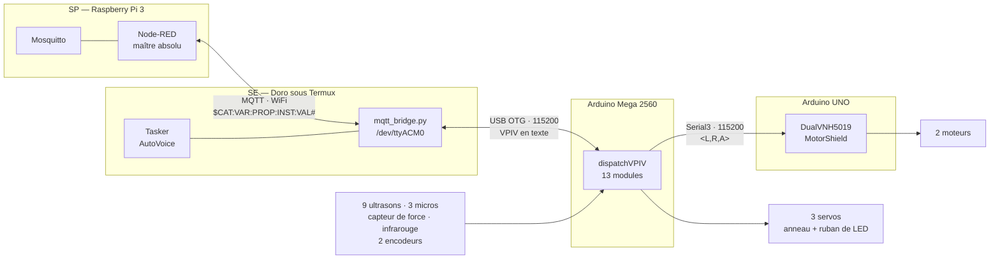

# Câblage du RobotRZ, reconstitué depuis le code

> **Ce document n'a pas été écrit en regardant le robot.** Il a été produit en lisant
> `config.h`, `config.cpp`, `us_hardware.cpp`, `src/uno/main.cpp` et `platformio.ini`.
> C'est sa force — il ne peut pas se désynchroniser du firmware — et c'est sa limite :
> **il décrit ce que le code attend, pas ce qui est effectivement soudé.**
>
> La table des broches se **régénère** : `python3 outils/vpiv/extraire_pins.py .`
> Ne jamais la recopier à la main. Le chantier des 20-22/10 a montré ce que coûte
> une table recopiée puis oubliée.
>
> *V1 — 23/10/2026 — Vincent Philippe / Claude*

---

## 1. Les trois liaisons, et ce qui circule dessus



**Le point à retenir** : le Raspberry Pi n'est **jamais** relié à la Mega par un fil. Il
parle MQTT en WiFi au Doro, et c'est le Doro qui tient le câble USB. Toute mention d'un
« com RPI ↔ Mega » dans un vieux document est un reste de l'architecture antérieure.

---

## 2. Doro ↔ Mega — la liaison dont vous n'étiez plus sûr

| | |
|---|---|
| **Support** | câble USB, du Doro vers le port USB de programmation de la Mega |
| **Côté Doro** | `/dev/ttyACM0` *(parfois `/dev/ttyUSB0` — à vérifier par `ls /dev/ttyACM*`)* |
| **Côté Mega** | `MAIN_SERIAL Serial`, donc **broches 0 (RX) et 1 (TX)** |
| **Vitesse** | **115200** des deux côtés — `BAUD_RATE` dans `mqtt_bridge.py`, `MAIN_BAUD` dans `config.h` |
| **Contenu** | des trames VPIV en texte, une par ligne |
| **Qui ouvre le port** | `termux/scripts/core/mqtt_bridge.py`, ligne 206 |

Le pont relaie dans les deux sens : ce qui arrive de MQTT part vers la Mega, ce que la
Mega émet remonte sur MQTT. La Mega ne sait rien de MQTT, le Node-RED ne sait rien du
port série.

> ⚠️ Les broches 0 et 1 sont aussi celles du téléversement. Le câble du Doro occupe le
> port USB : **pour reprogrammer la Mega, il faut le débrancher.**

---

## 3. Mega ↔ UNO — la jonction à vérifier au montage

| | Mega | UNO |
|---|---|---|
| Port logiciel | `MOTEURS_SERIAL Serial3` | `MEGA_SERIAL Serial` |
| Broches | **14 (TX3)** et **15 (RX3)** | **1 (TX)** et **0 (RX)** |
| Vitesse | `MOTEURS_BAUD 115200` | `SERIAL_BAUD 115200` |

Le croisement, et la masse commune :

```
   Mega  14 (TX3)  ──────────────►  UNO  0 (RX)
   Mega  15 (RX3)  ◄──────────────  UNO  1 (TX)
   Mega  GND       ───────────────  UNO  GND        ← indispensable
```

**Ce qui circule** : des trames `<L,R,A>` — `L` et `R` signés de −400 à +400, `A` le
niveau de lissage de 0 à 4. **Ce n'est pas du VPIV** : l'UNO ne connaît pas le protocole.
La Mega traduit.

L'UNO coupe les moteurs s'il ne reçoit plus rien pendant `TIMEOUT_MS = 1000` ms.

> ⚠️ **Deux pièges de montage sur cette liaison.**
>
> L'UNO n'a qu'une seule liaison série matérielle, et c'est celle de son port USB. Tant
> que le fil de la Mega est en place, **téléverser sur l'UNO par USB est impossible** —
> et un moniteur série ouvert sur l'UNO injecterait des caractères dans la liaison.
>
> C'est d'ailleurs pourquoi `src/uno/main.cpp` prévient, ligne 219, de ne pas appeler
> `Serial.print()` en fonctionnement normal : la sortie de débogage et la liaison moteur
> sont le même fil.

### Une erreur dans le commentaire de l'UNO — mais une seule

`src/uno/main.cpp`, ligne 5 :

```c
 * Reçoit via Serial1 (depuis la Mega) des trames :
```

**Un UNO n'a pas de `Serial1`.** *Corrigé le 23/10.*

> **Et le reste de cet entête était déjà juste.** Vingt-cinq lignes plus bas, il porte
> déjà l'essentiel de ce paragraphe :
>
> ```
> *on n'utilise pas software serial volontairement,
> *débrancher de Mega pour téléchargement sur la uno.
> *Attention relié les GND mega <-> uno + Uno RX pin 0 et TX pin 1 vers Mega serial 3
> ```
>
> Masse commune, croisement, contrainte de téléversement : tout y est. **La jonction
> Mega ↔ UNO était documentée depuis le début, et correctement** — c'est le nom du port,
> trois lignes plus haut, qui contredisait le reste.

---

## 4. UNO ↔ moteurs — le bouclier

Bouclier **Pololu Dual VNH5019**, bibliothèque `pololu/DualVNH5019MotorShield@^3.0.0`
déclarée dans `platformio.ini`.

Le brochage du bouclier **n'est pas dans ce dépôt** : la bibliothèque est téléchargée par
PlatformIO, pas versionnée. Le code n'impose aucun brochage — `DualVNH5019MotorShield md;`
est construit sans argument, donc avec les broches par défaut de la bibliothèque.

> **C'est la seule partie de ce document que je n'ai pas pu lire.** Comme vous l'avez dit,
> le bouclier s'empile et son câblage ne bouge pas : il n'y a rien à vérifier au montage
> de ce côté, hormis l'alimentation de puissance et la polarité des deux moteurs.

---

## 5. La table des broches de la Mega — extraite du code

37 broches utilisées. **Table générée, non recopiée.**

| Broche | Constante dans le code | Module | Rôle |
|---|---|---|---|
| **0** | `Serial RX` | `com` | liaison USB vers le Doro (SE) @ 115200 |
| **1** | `Serial TX` | `com` | liaison USB vers le Doro (SE) @ 115200 |
| **2** | `ODO_ENCODER_GA_PIN` | `odom` | encodeur roue **gauche**, voie A |
| **3** | `ODO_ENCODER_DB_PIN` | `odom` | encodeur roue **droite**, voie B |
| **4** | `SERVO_TGD_PIN` | `srv` | servo tête, mouvement horizontal |
| **5** | `SERVO_THB_PIN` | `srv` | servo tête, mouvement vertical |
| **6** | `LRING_PIN` | `lring` | anneau de LED — 12 instances |
| **8** | `MVT_IR_PIN` | `mvt_ir` | détecteur de mouvement infrarouge |
| **9** | `SERVO_BASE_PIN` | `srv` | servo de la base |
| **10** | `LRUB_PIN` | `lrub` | ruban de LED — 15 instances |
| **14** | `Serial3 TX` | `com` | vers l'UNO moteurs @ 115200 |
| **15** | `Serial3 RX` | `com` | depuis l'UNO moteurs @ 115200 |
| **18** | `ODO_ENCODER_DA_PIN` | `odom` | encodeur roue **droite**, voie A |
| **19** | `ODO_ENCODER_GB_PIN` | `odom` | encodeur roue **gauche**, voie B |
| **26 / 27** | `usTrigPins[6]` / `usEchoPins[6]` | `us` | ultrason **TtG** |
| **28 / 29** | `usTrigPins[7]` / `usEchoPins[7]` | `us` | ultrason **TtD** |
| **30 / 31** | `usTrigPins[8]` / `usEchoPins[8]` | `us` | ultrason **TtC** |
| **32 / 33** | `usTrigPins[0]` / `usEchoPins[0]` | `us` | ultrason **ArG** |
| **34 / 35** | `usTrigPins[1]` / `usEchoPins[1]` | `us` | ultrason **ArC** |
| **36 / 37** | `usTrigPins[2]` / `usEchoPins[2]` | `us` | ultrason **ArD** |
| **38 / 39** | `usTrigPins[3]` / `usEchoPins[3]` | `us` | ultrason **AvD** |
| **40 / 41** | `usTrigPins[4]` / `usEchoPins[4]` | `us` | ultrason **AvC** |
| **42 / 43** | `usTrigPins[5]` / `usEchoPins[5]` | `us` | ultrason **AvG** |
| **A1** | `MIC_AV_PIN` | `mic` | micro avant |
| **A2** | `MIC_G_PIN` | `mic` | micro gauche |
| **A3** | `MIC_D_PIN` | `mic` | micro droit |
| **A4** | `FS_DOUT_PIN` | `fs` | capteur de force HX711 — DATA |
| **A5** | `FS_SCK_PIN` | `fs` | capteur de force HX711 — CLOCK |

### Les quatre broches d'encodeur sont un choix, pas un hasard

`2, 3, 18, 19` sont quatre des six broches à interruption externe d'une Mega 2560.
Les deux voies de chaque encodeur sont donc sur interruption, ce que la bibliothèque
`paulstoffregen/Encoder` exploite pour compter en quadrature sans rien perdre.

> **La contrepartie, à connaître** : 18 et 19 sont aussi `Serial1`. Les utiliser en
> encodeurs rend **`Serial1` indisponible**. Il reste `Serial2` (16/17) si une troisième
> liaison série devenait nécessaire.

### Broches libres — 33

```
7  11  12  13  16  17  20  21  22  23  24  25
44 45  46  47  48  49  50  51  52  53
A0 A6  A7  A8  A9  A10 A11 A12 A13 A14 A15
```

`20` et `21` sont les broches I²C (SDA/SCL) : libres, mais à réserver si un périphérique
I²C arrive un jour. `50` à `53` sont le SPI.

---

## 6. Écarts avec le tableau `Pin-Old-Pour_exemple.ods`

Vous le donniez comme « non mis à jour ». **Les broches, elles, sont toutes justes** —
les 37 concordent avec le code, sans exception. Ce qui a vieilli, ce sont les libellés.

| # | Le tableau dit | Le code dit | Portée |
|---|---|---|---|
| 1 | Broches 0/1 : « com RPI Mega » | liaison vers le **Doro**, en USB | 🔴 induit en erreur sur l'architecture |
| 2 | Broches 14/15 : « Uno - 11 » | l'UNO utilise son **Serial matériel, broches 0/1** | 🔴 ferait câbler au mauvais endroit |
| 3 | Broche 7 : `BUZZER` | **aucun buzzer dans le code** — la broche est libre | ⚠️ votre propre commentaire le disait déjà |
| 4 | Broche 18 : abréviation `encL` | c'est l'encodeur **droit** (`ODO_ENCODER_DA_PIN`) | ⚠️ la colonne « Ref PIN » est juste, l'abréviation non |
| 5 | Broche 19 : abréviation `encR` | c'est l'encodeur **gauche** (`ODO_ENCODER_GB_PIN`) | ⚠️ idem |
| 6 | Broches 18/19 : « Serial 1 TX / RX » | ce **sont** les broches de `Serial1`, mais elles servent d'entrées encodeur | ℹ️ à reformuler, pas faux |
| 7 | Ultrasons de tête : `Stg`, `StD`, `StE` | `TtG`, `TtD`, `TtC` — comme la Table A | ⚠️ trois noms d'instance |
| 8 | `HX_DOUT`, `HX_CLK`, `IR_PIN`, `ODOM_LEFT_A_PIN`… | `FS_DOUT_PIN`, `FS_SCK_PIN`, `MVT_IR_PIN`, `ODO_ENCODER_GA_PIN`… | ℹ️ renommages, sans conséquence |

Les écarts 1 et 2 sont les seuls qui coûteraient cher au montage.

---

## 7. Deux dépendances déclarées et jamais utilisées

Trouvées en lisant `platformio.ini` :

| Bibliothèque | Utilisée ? |
|---|---|
| `adafruit/Adafruit NeoPixel` | ✅ 4 fichiers |
| `bogde/HX711` | ✅ 6 fichiers |
| `paulstoffregen/Encoder` | ✅ 2 fichiers |
| `arduino-libraries/Arduino_LSM6DS3` | 🔴 **0 fichier** |
| `teckel12/NewPing` | 🔴 **0 fichier** |

`Arduino_LSM6DS3` est une centrale inertielle. **Il n'y en a pas sur la Mega** : le gyro
vient du Doro, par la trame VPIV, et entre dans l'odométrie par `odom_receiveGyro()`
(`odom.cpp:527`). La dépendance est un reste.

`NewPing` ne sert pas non plus : `us_hardware.cpp` déclenche et mesure à la main —
`digitalWrite` 10 µs puis `pulseIn(echo, HIGH, 30000)`. Votre tableau porte d'ailleurs
« NewPing » dans une cellule : c'est une intention qui n'a pas été suivie.

> Les retirer de `lib_deps` allégerait la compilation. **Non fait** : à décider.

---

## 8. Ce que ce document ne dit pas, et qu'il faudra relever au montage

| Point | Pourquoi il manque |
|---|---|
| Alimentation : tensions, régulateurs, répartition | n'apparaît nulle part dans le code |
| Masses communes autres que Mega ↔ UNO | idem |
| Brochage réel du bouclier Pololu | bibliothèque non versionnée |
| Couleurs de fils | seul `Pin-Old-Pour_exemple.ods` les porte — à reprendre de là |
| Orientation gauche/droite | ⚠️ **à confirmer** — voir ci-dessous |
| Résistances, condensateurs, protections | aucune trace |

Les couleurs de fils de votre tableau sont la seule information qu'il porte et que le
code ne portera jamais. **À conserver**, même après mise à jour du reste.

---

*Fin du document. Table régénérable : `python3 outils/vpiv/extraire_pins.py .`*

---

## 9. Ce que les noms disent — précisions de Vincent, 23/10/2026

Le code en sait plus que ses `#define` : les **noms d'instance** portent la géométrie, et
les commentaires de `lring` et `lrub` portent en plus les numéros de LED.

### Les neuf ultrasons

| Préfixe | Position |
|---|---|
| `Tt` | **Tête** — `TtG` gauche, `TtD` droite, `TtC` centre |
| `Ar` | **Arrière** — `ArG` gauche, `ArC` centre, `ArD` droite |
| `Av` | **Avant** — `AvG` gauche, `AvC` centre, `AvD` droite |

> ⚠️ Le tableau `Pin-Old-Pour_exemple.ods` écrit `Stg`, `StD`, `StE` pour la tête. Le `S`
> et le `E` final n'ont plus cours : le code et la Table A disent `Tt` et `TtC`.

### Les trois servomoteurs — ils s'empilent

De haut en bas, sous la tête qui portera le Doro :

```
        ┌──────────────┐
        │  Tête + Doro │
        └──────┬───────┘
     SERVO_TGD │  broche 4   — rotation de la tête, Gauche ↔ Droite
     SERVO_THB │  broche 5   — inclinaison de la tête, Haut ↔ Bas
    SERVO_BASE │  broche 9   — sous les deux autres, mouvement de la base
        ┌──────┴───────┐
        │    Châssis   │
        └──────────────┘
```

`TGD` = **T**ête **G**auche-**D**roite · `THB` = **T**ête **H**aut-**B**as.

### 🔴 Un point non tranché : l'orientation

> *« Reste à vérifier l'orientation de la gauche et de la droite, je crois que j'ai pris
> comme référence le robot. »*

**Rien dans le code ne le dit.** Un `ArG` peut désigner l'arrière-gauche *du robot* ou
celui *de l'observateur qui lui fait face* — et les deux sont opposés.

Cela concerne les neuf ultrasons, les deux encodeurs (`ODO_ENCODER_G*` / `D*`), les deux
moteurs via `<L,R,A>`, les trois micros (`MIC_G_PIN`, `MIC_D_PIN`) et `SERVO_TGD`.

**La vérification tient en un geste**, à faire au montage : poser la main devant un seul
ultrason et lire quelle instance réagit. Une mesure tranche les cinq familles d'un coup,
puisqu'elles suivent toutes la même convention. Inscrit en §1.2 de
`travaux_robot_assemble.md`.

### Les LED portent leurs numéros dans les commentaires

`LRING_PIN` (broche 6) et `LRUB_PIN` (broche 10) ne sont qu'une broche chacun : la
distinction se fait par **index de LED** dans la chaîne — 12 instances pour l'anneau,
15 pour le ruban. Ces correspondances sont dans les commentaires de `lring.cpp` et
`lrub.cpp`, pas dans la table des broches, qui ne peut pas les porter.
