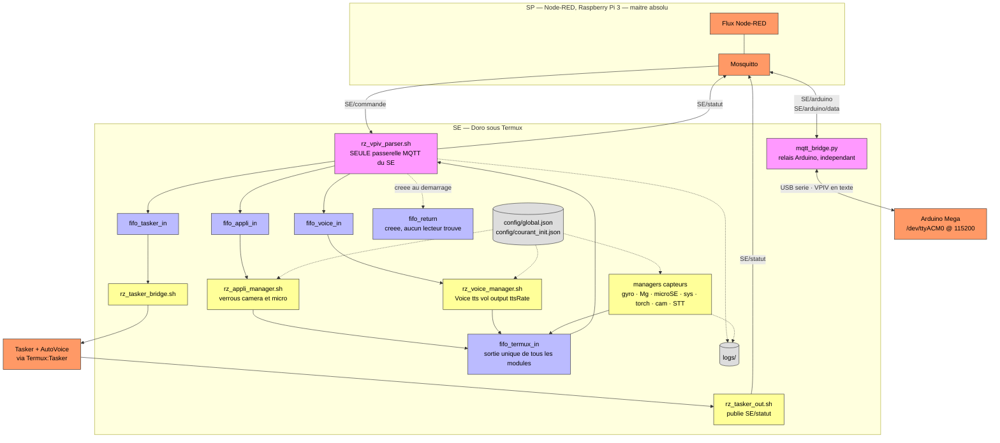
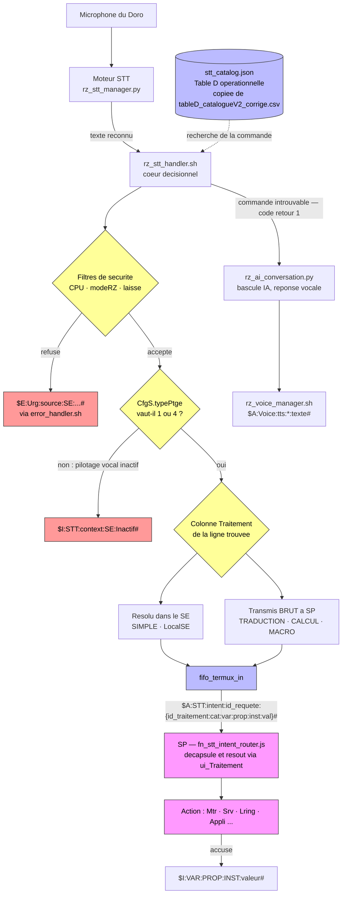
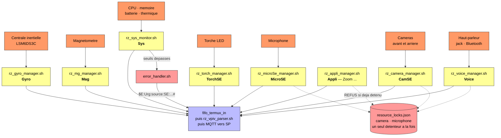

# Les trois schémas du SE, redessinés depuis le code

> Ces schémas remplacent `SE_diagram`, `Termux_STT_Intent_Routing_Flow` et
> `VPIV_Termux_Sensor_Integration_Architecture`, datés du 23/10/2026 au matin.
> **La structure des originaux était bonne** — c'est ce qui a permis de les refaire vite.
> Ce sont les étiquettes qui avaient vieilli : six trames VPIV sur sept étaient fausses,
> et trois variables n'existaient pas.
>
> Chaque schéma a été **rendu par Mermaid** avant d'être livré, pas seulement écrit.
> Sources : `docs/schemas/*.mmd`, réouvrables dans l'éditeur Mermaid.
>
> *V1 — 23/10/2026 — Vincent Philippe / Claude*

---

## 1. Architecture du SE — le circuit d'une trame

### Ce que ce schéma corrige

| L'ancien disait | La réalité |
|---|---|
| trois FIFO | **cinq** : `fifo_termux_in`, `fifo_tasker_in`, `fifo_appli_in`, `fifo_voice_in`, `fifo_return` *(liste de `rz_start.sh` l.264-269)* |
| `/sdcard/rz_vars.json` | `config/global.json` et `config/courant_init.json`, sous `$BASE_DIR` |
| `/sdcard/rz_logs/` | `$BASE_DIR/logs` |
| « Décodeur » et « Encodeur » séparés | **un seul** `rz_vpiv_parser.sh`, qui fait les deux et reste la **seule** passerelle MQTT du SE |
| la caméra parle directement à SP | elle passe par `rz_camera_manager.sh`, comme les autres |

### Et ce qu'il ajoute

**Le relais Arduino est un chemin indépendant.** `mqtt_bridge.py` a ses propres topics
(`SE/arduino` et `SE/arduino/data`) et ne passe pas par le parser. Le Doro est, pour le
trafic Arduino, un simple relais entre MQTT et le port série — il ne l'interprète pas.

**`fifo_return` est créée au démarrage mais aucun script du dépôt ne la lit.** Soit un
lecteur manque, soit la FIFO ne sert plus. À trancher.

**`fifo.manager.sh` est périmé** : il ne liste que quatre FIFO, il oublie `fifo_voice_in`.
C'est `rz_start.sh` qui fait foi.

---

## 2. Routage d'une commande vocale

### Ce que ce schéma corrige

| L'ancien disait | La réalité |
|---|---|
| `$A:TTS:speak:*:Bonjour#` | **`TTS` n'est pas une variable** : c'est `$A:Voice:tts:*:"Bonjour"#` |
| `$A:Mtr:speed:*:50#` | **`speed` n'existe pas** — `act`, `cmd`, `kturn`, `override`, `read`, `scale`, `state`, `stop`, `targets` |
| `$I:EchVoc:*:1#` | **`EchVoc` n'existe pas**, et la trame n'avait que 4 champs |
| `$E:STT:error:*:unknown#` | **`error` n'est pas une propriété de STT** — `context`, `intent`, `modeSTT`, `paraSTT`, `state` |
| « modePtge » | `modePtge` est un **nom de variable shell** dans `rz_state-manager.sh`, qui lit `CfgS.typePtge`. Ce n'est pas un nom du protocole |
| Table D : `Catégorie / Scope / Context` | modèle à 7 champs, remplacé par la Table D réelle à 16 colonnes |

### Et ce qu'il ajoute — la bifurcation que l'ancien manquait

**La colonne `Traitement` de la Table D décide de tout** *(`rz_stt_handler.sh`, entête)* :

- `SIMPLE` et `LocalSE` → le SE résout seul ;
- `TRADUCTION`, `CALCUL`, `MACRO` → la commande part **brute** vers SP, qui la résout par
  le mécanisme générique `ui_Traitement`.

L'ancien schéma ne montrait qu'un seul chemin. Il en existe deux, et c'est cette colonne
qui choisit.

Le reste de ce qu'il ajoute : les filtres de sécurité en amont (CPU, `modeRZ`, laisse),
la bascule IA quand la commande est introuvable (code retour 1), et la forme réelle de
la trame encapsulée — l'identifiant de requête voyage dans l'**instance**.

---

## 3. Capteurs et verrous de ressources

### Ce que ce schéma corrige

| L'ancien disait | La réalité |
|---|---|
| variable `Torch` | **`TorchSE`** |
| variable `Light` | **n'existe pas** — aucune variable de luminosité dans la Table A |
| `CamSE.front.resolution=720p` | `resolution` est une clé **à l'intérieur** du JSON `paraCam`, pas une propriété |
| `Gyro.active=On` | les propriétés de `Gyro` sont `angleVSEBase`, `dataContGyro`, `dataMoyGyro`, `modeGyro`, `paraGyro`, `statusGyro` |

### Et ce qu'il ajoute — l'arbitrage, qui était absent

**La caméra et le microphone sont des ressources exclusives.** `resource_locks.json` ne
tolère qu'un détenteur à la fois, et `rz_appli_manager.sh` (l.161-190) **refuse** d'ouvrir
Zoom si la caméra ou le micro sont déjà pris.

L'ancien schéma montrait caméra, micro, Zoom et TTS comme des branches parallèles qui
s'ignorent. **Elles se disputent le matériel**, et c'est précisément ce que le code
s'applique à arbitrer.

Second ajout : `rz_sys_monitor.sh` passe par `error_handler.sh` quand un seuil est
dépassé, et c'est de là que partent les trames `Urg` du SE.

---

## 4. Ce que ces schémas ont permis de trouver

Les refaire a mis au jour **un script mort** : `termux/rz_mqtt_listener.sh`, supprimé le
23/10. Il écoutait `$A:TTS:speak:` — donc le schéma ne mentait pas, il décrivait ce
script. Mais rien ne le lançait, il appelait `mosquitto_sub` et `mosquitto_pub` en direct
contre la règle absolue du projet, et sa branche Zoom ouvrait l'application sans vérifier
aucun verrou, là où `rz_appli_manager.sh` arbitre.

---

*Sources Mermaid : `docs/schemas/`. Les trois ont été rendus avant livraison.*
