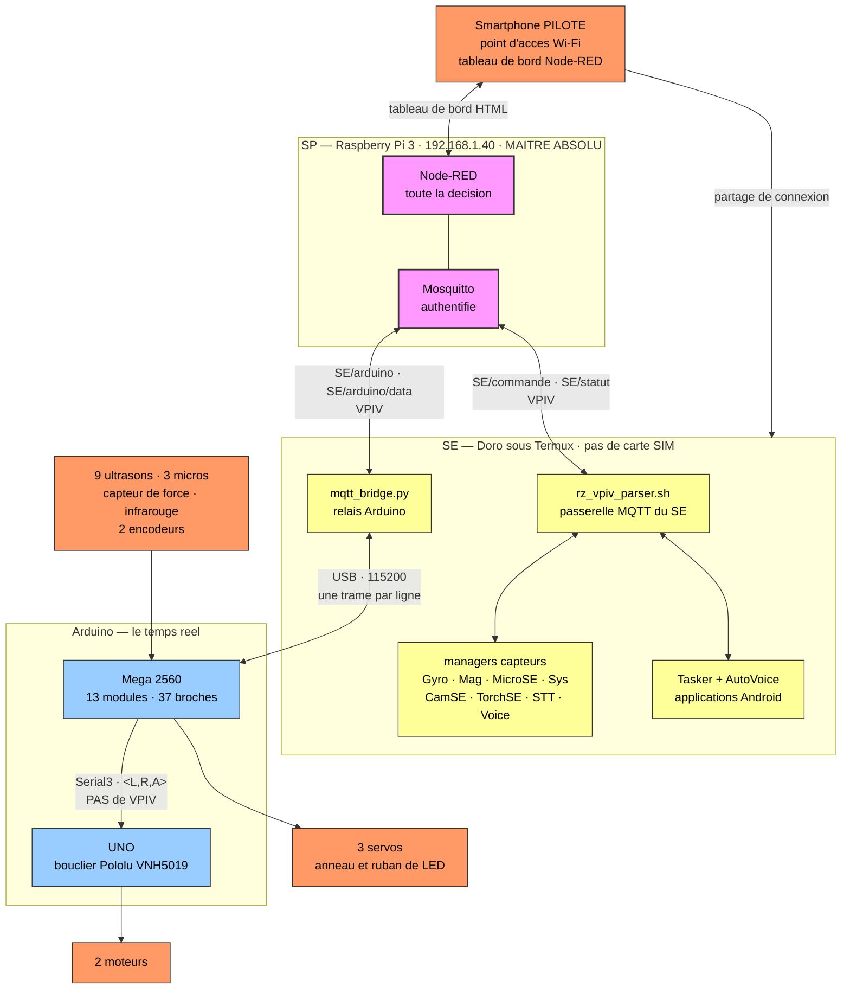

# RobotRZ — synthèse générale

> **Fichier** : `docs/synthese_generale_RobotRZ.md`
> **Objet** : l'entrée unique du projet. Ce qu'est RobotRZ, comment il est fait,
> et **où trouver chaque chose**. C'est le document à ouvrir en premier, après
> une interruption ou pour s'y retrouver.
>
> **⚠ À ne pas confondre avec `docs/synthese_etat.md`.** Celui-ci dit ce que le
> projet **est** — il bouge peu. L'autre dit **où il en est** — il change à
> chaque séance. En cas de doute sur l'avancement, c'est l'autre qui fait foi.
>
> **Ce qu'il ne fait pas** : recopier les documents de référence. Chaque
> chapitre donne l'essentiel et renvoie. Recopier, c'est fabriquer la
> divergence silencieuse — deux textes qui disent la même chose jusqu'au jour
> où l'un est corrigé et pas l'autre. Le projet en a assez souffert.
>
> **Version** : 1.0 — 22/10/2026 — Vincent Philippe

---

## 1. Le projet en une page

RobotRZ est un **robot compagnon mobile**, piloté à distance ou en autonomie,
développé bénévolement par Vincent Philippe.

Son intelligence est répartie entre **quatre sous-systèmes** qui échangent tous
dans un **protocole unique, VPIV**, transporté par MQTT et par liaison série.

| | Rôle | Technologie |
|---|---|---|
| **SP** — Système Pilote | **Maître absolu.** Décide de tous les modes, envoie la configuration, porte l'interface, traite les alertes | Node-RED sur RPi 3 · secours sur Xiaomi |
| **SE** — Smartphone Embarqué | Cerveau local. Traite les commandes de SP, gère les capteurs du téléphone, reconnaissance vocale, relaie vers Arduino | Android · Termux · Tasker |
| **A** — Arduino Mega | Contrôleur temps réel des capteurs et actionneurs physiques | C++ · PlatformIO |
| **UNO** | Esclave moteur exclusif, invisible depuis SE et SP | C++ |

```
        SP  (Node-RED, RPi 3 — 192.168.1.40)
         ↕  MQTT          topics SE/commande et SE/statut
        SE  (Doro — Termux, Tasker ; pas de carte SIM)
         ↕  USB-C série
      Mega  (capteurs, actionneurs, sécurité)
         ↕  Serial3, format <L,R,A>
       UNO  (moteurs)
```

**Trois principes gouvernent l'ensemble**, et ils expliquent la plupart des
choix de conception :

1. **SP est la seule source de vérité logique.** Aucune décision non
   strictement matérielle n'est prise ailleurs.
2. **Chaque appareil gère ses tâches bas niveau** et n'échange que le
   nécessaire.
3. **L'Arduino garde une sécurité autonome.** Il arrête les moteurs sans
   attendre SP, et ne les réactive jamais de lui-même.

---

### Le robot en un schéma



**Trois choses que ce schéma existe pour rendre évidentes.**

**SP est le maître absolu, et les trois branches ne se parlent jamais entre elles.**
Un capteur du Doro qui doit agir sur un moteur ne s'adresse pas à l'Arduino : il signale
à SP, qui décide et commande. C'est l'invariant du §6, et il se voit.

**Le Raspberry n'est relié à l'Arduino par aucun fil.** C'est le Doro qui tient le câble
USB ; le Raspberry lui parle MQTT en Wi-Fi. Tout document qui mentionne une liaison série
« RPi ↔ Mega » décrit l'architecture antérieure.

**L'UNO ne connaît pas VPIV.** La Mega traduit en `<L,R,A>` avant de lui transmettre.
Détail en §3 de `docs/cablage_RZ_depuis_le_code.md`.

---

## 2. L'index — où trouver quoi

### Les documents de référence, dans le dépôt

| Document | Répond à |
|---|---|
| **`BRANCHES.md`** *(racine)* | **Quelle branche est laquelle.** `main` seule sert au développement ; `master`, `vMars` et la sauvegarde sont figées |
| **`synthese_etat.md`** | **Où en est le projet ?** Avancement, lots, bugs ouverts, pièges connus. Change à chaque séance |
| `tables_RZ_descripteur.md` | Les quatre tables, les quinze champs de la Table A, les règles du protocole VPIV |
| 🔴 **`convention_VPIV_ordre.md`** | **Pourquoi l'ordre des champs a été faux partout, et ce qui fait foi désormais.** À lire avant de recopier le moindre exemple de trame |
| `reference_firmware_arduino.md` | Le code Arduino : organisation, boucle, traitement d'une trame, urgences, pièges |
| `reference_SE_termux_tasker.md` | Le code SE : démarrage, parser VPIV, FIFOs, état, managers, chaîne vocale, pièges |
| `reference_Tasker.md` | La couche Android : démarrage du robot, routeur, arbitrage vocal, scènes, pièges |
| `genese_et_evolution_RZ.md` | Pourquoi ce robot existe, et comment il est passé de la V0 à la V6 |
| `installation_RPI_serveur.md` | Installer le RPi serveur de zéro — réseau, Node-RED, Mosquitto, accès distant |
| `travaux_robot_assemble.md` | Tout ce qui exige le robot monté, groupé en une campagne |
| `cablage_RZ_depuis_le_code.md` | Les trois liaisons, le brochage de la Mega, les pièges de montage — **extrait du code, régénérable** |
| `schemas_SE.md` | Trois schémas du SE : circuit d'une trame, routage vocal, capteurs et verrous — sources Mermaid dans `docs/schemas/` |
| `dev_RZ_HTML/index.html` | Le site de documentation, une vingtaine de pages thématiques |
| `dev_RZ_HTML/vademecum_documentation_V1.html` | Où ranger un document, lequel fait foi en cas d'écart |

### Les données

| | Où |
|---|---|
| Table A, C, D et leur légende | `AA-Doc-horsGit\A - Architecture_Tables_Schemas\Tables\TablesRZ_reference.ods` |
| Table B (runtime Node-RED) | `node-red/config/globalSave.json` — générée, ne pas éditer à la main |
| Flux Node-RED | `node-red/flows/` — un export daté par séance |
| Firmware | `src/mega/`, `src/uno/`, `lib/RZlibrairiesPersoNew/` |
| Scripts SE | `termux/` |
| Tasker | `tasker/` |
| 🔒 Identifiants | `AA-Doc-horsGit\Z - Secret\RZ_Codes_Identifiants.odt` — et nulle part ailleurs |

### Les questions fréquentes

| | |
|---|---|
| Le nom exact d'une variable ou d'une propriété | Table A |
| Ce que le firmware accepte réellement | `reference_firmware_arduino.md` §9 |
| Pourquoi tel choix a été fait | `genese_et_evolution_RZ.md` |
| Un piège déjà rencontré | `synthese_etat.md`, section « Pièges à ne pas réveiller » |
| Où ranger un document | Le vade-mecum, ou `AA-Doc-horsGit\LISEZ-MOI.md` |

---

## 3. Le protocole VPIV

Tout message échangé, quel que soit le support, suit ce format :

```
$CAT:VAR:PROP:INST:VAL#
```

| Champ | Rôle | Exemples |
|---|---|---|
| **CAT** | Type du message | `V` consigne · `I` info et ACK · `E` urgence · `F` flux · `A` application |
| **VAR** | Module concerné | `Gyro`, `Mtr`, `CfgS`, `Urg` |
| **PROP** | Propriété | `modeRZ`, `angle`, `dataContCpu` |
| **INST** | Instance, ou `*` | `TGD`, `rear`, `*` |

> 🔴 **La propriété précède l'instance, et c'est le piège numéro un du projet.**
> La convention a changé en cours de route, mais la colonne `VPIV_EX` de la Table A
> n'a pas suivi : 150 de ses 251 exemples sont restés à l'ancien ordre
> `$CAT:VAR:INST:PROP:VAL#`. Comme c'est la colonne que tout le monde lit, l'erreur
> s'est propagée aux commentaires du firmware, aux documents archivés, aux légendes,
> et jusqu'au **code de réception de la Mega — qui ne pouvait donc recevoir aucune
> commande**. Tout a été corrigé le 22/10/2026.
>
> **Avant de recopier un exemple de trame, vérifier sa source** : `convention_VPIV_ordre.md` §5.1
> donne le tableau de confiance. En deux mots — le dépôt est fiable depuis le 22/10,
> `AA-Doc-horsGit/` ne l'est pas.
| **VAL** | Valeur | `3`, `90`, `[x,y,z]` |

> 🔴 **PROP en position 3, INST en position 4.** Ne jamais intervertir. Cette
> inversion est l'erreur la plus répandue du projet : elle a contaminé deux
> fichiers de légende, les deux tiers d'un document Arduino, et le code de
> réception du firmware lui-même, où elle empêchait la Mega de recevoir la
> moindre commande jusqu'au 22/10/2026.

**Deux autres règles absolues :**

- **Jamais de nombre à virgule sur le fil.** Entiers multipliés par 10, 100 ou
  1000 selon la précision voulue.
- **`VPIV_MAX_MSG_LEN = 128`** — `config/config.h` ligne 18.

Détail complet : `tables_RZ_descripteur.md` §5.

---

## 4. Les quatre tables

| | Rôle | Où elle vit |
|---|---|---|
| **A** | **Référence normative.** Toutes les variables VPIV, leurs propriétés, formats, instances, directions. 253 lignes, 15 colonnes. **Jamais chargée à l'exécution** — c'est un document de conception | PC, dans Calc |
| **B** | Image de travail de Node-RED (`enrichedVars`), générée depuis la Table C | `globalSave.json`, RPi |
| **C** | Modèle de persistance et d'initialisation. 23 variables, 80 propriétés. Éditée par l'onglet `ui_VarG` | `TableC.json`, sur SP |
| **D** | Catalogue des commandes vocales. 72 commandes, 16 colonnes | `tableD_catalogueV2.csv`, sur SE |

```
TableC.json  →  globalSave.json (B)  →  courant_init.json (projection vers SE)
```

**L'autorité**, règle du 18/10/2026 :

> Le **PC** est l'atelier de conception : la Table A y vit, en tête de chaîne.
> Le **RPi** porte l'autorité d'exécution pour B, C et D.
> Chaque sous-système garde une **copie locale persistante** qui lui permet de
> démarrer seul ; SP l'écrase après `SE_READY`.
> Le **Xiaomi** reçoit un clone daté **avant** toute panne, jamais pendant.

---

## 5. Les sous-systèmes

> **Trois schémas détaillent ce chapitre** — `docs/schemas_SE.md` : le circuit d'une
> trame dans le SE, le routage d'une commande vocale, et les capteurs avec leur
> arbitrage de ressources. Sources Mermaid dans `docs/schemas/`, toutes rendues
> avant publication.


### 5.1 SP — le maître

Node-RED sur Raspberry Pi 3, à `192.168.1.40`. Sept onglets :

| Onglet | Rôle |
|---|---|
| `Gtion_Init` | Initialisation — charge `enrichedVars` |
| `RZ_GestionFlux_V3` | Bus VPIV : parsing, routage, encodage |
| `Gtion_EtatGlobal_V2` | Règles métier, décisions de `modeRZ` |
| `ui_Accueil_v4` | Interface utilisateur |
| `ui_VarG` | Éditeur de la Table C — page `/admin_varG` |
| `Diag_SE_Statut` | Diagnostic SE en temps réel |
| `B2_Variables_Complexes` | Variables structurées |

`RZ_GestionFlux_V3` alimente `global.RZ_<VAR>` à chaque trame reçue. Accès type :
`global.get('RZ_Sys').dataContCpu._last`.

Un clone de secours tourne sur le Xiaomi. **Ce n'est pas un clone exact** : six
onglets n'existent que là, et leur rapatriement est en cours — voir
`synthese_etat.md` §4.9 et §4.10.

### 5.2 SE — le cerveau local

Android + Termux, sans carte SIM. Se connecte par Wi-Fi, ou par partage de
connexion.

**Deux voies, et la séparation est nette.** Termux porte la communication, les
capteurs et la logique ; Tasker porte tout ce qui touche aux applications
Android.

Scripts centraux :

| Script | Rôle |
|---|---|
| `rz_vpiv_parser.sh` | Démon MQTT ↔ FIFO |
| `rz_state-manager.sh` | État global, `global.json` |
| `mqtt_bridge.py` | Pont vers l'Arduino par USB-C |
| `safety_stop.sh` | Arrêt d'urgence |

Les **FIFOs** sont les tuyaux internes entre processus, sans passer par MQTT :
`fifo_termux_in`, `fifo_tasker_in`, `fifo_appli_in`, `fifo_voice_in`,
`fifo_return`.

Les **managers de capteurs** — gyroscope, magnétomètre, système, caméra, micro,
reconnaissance vocale, synthèse vocale, torche — suivent tous le même modèle :
une boucle non bloquante, un mode de fonctionnement, une publication VPIV.

`global.json` est la mémoire partagée de SE : tous les managers y lisent et y
écrivent, et c'est la source de vérité de l'état courant côté embarqué.

### 5.3 Arduino — le temps réel

Mega 2560 pour les capteurs, actionneurs et la sécurité. UNO esclave pour les
moteurs seuls.

Toute l'organisation du code obéit à une **règle de trois couches** —
matériel, métier, communication — et aucun dispatcher ne calcule ni ne touche
au matériel.

Détail complet : `reference_firmware_arduino.md`.

> Le pendant SE est `reference_SE_termux_tasker.md`.

### 5.4 Tasker — les applications Android

Gère ce que seul Android sait faire : Zoom, caméra de surveillance, GPS,
expressions faciales sur l'écran, synthèse vocale. Reçoit des trames de
catégorie `A`, que l'Arduino ignore totalement.

> 🔴 **C'est Tasker qui démarre le robot.** La tâche `RZ_Init_Tasker` lance
> `rz_start.sh` par le greffon Termux:Tasker, attend les démons, puis met en
> place l'affichage. Un SE qui ne démarre pas se diagnostique d'abord ici.

Détail complet : `reference_Tasker.md`.

---

## 6. Les invariants

Ce qui ne se négocie pas, quelle que soit la partie du projet.

**Protocole.** `$CAT:VAR:PROP:INST:VAL#`, PROP en 3, INST en 4. Jamais de
flottant sur le fil. 128 caractères au maximum.

**Autorité.** SP décide. L'Arduino n'obéit qu'à SP, mais garde sa sécurité
autonome : il arrête les moteurs de lui-même et **ne les réactive jamais sans
ordre explicite**.

**Sécurité.** Les identifiants vivent dans un seul fichier, dans `Z - Secret`,
hors dépôt et chiffré. Ne jamais afficher le résultat de `git remote -v` — le
jeton y figure en clair. Ne jamais publier une adresse IPv6 : contrairement à
l'IPv4, elle désigne la machine et ne passe par aucun NAT.

**Documentation.** Le thème décide du dossier, l'âge décide de la place à
l'intérieur. Une version dépassée descend dans le `old\` de sa propre lettre.

**Node-RED.** Exporter les flux en fin de chaque séance, sans exception.
Node-RED ne versionne rien.

---

## 7. Urgences et erreurs

*Versé le 23/10/2026 depuis `urgence-gestion.odt` et `synthèseRZ.odt` (28/02/2026),
après confrontation ligne à ligne au code des deux côtés. Les noms de propriétés de ces
documents étaient périmés ; la structure qu'ils décrivaient, non.*

### 7.1 Le principe : urgence et erreur ne sont pas la même chose

| | Urgence | Erreur non critique |
|---|---|---|
| Variable | `Urg` | `COM` |
| Catégorie | `E` à la détection, `I` pour l'état | `I` |
| Effet | arrêt moteur, verrouillage des commandes | **aucun** — trace seulement |
| Levée | explicite, par `$V:Urg:clear:*:1#` | sans objet |

Confondre les deux est le piège : une erreur de parsing ne doit pas immobiliser le robot,
une batterie faible doit l'immobiliser.

### 7.2 Les quatre propriétés de `Urg`

| Propriété | CAT | Rôle | Exemple réel |
|---|---|---|---|
| `source` | `E` | la cause, normalisée | `$E:Urg:source:SE:URG_CPU_CHARGE#` |
| `statut` | `I` | active ou levée | `$I:Urg:statut:SE:active#` |
| `niveau` | `I` | `warn` ou `danger` | `$I:Urg:niveau:SE:danger#` |
| `etat` | `E` / `I` | état consolidé | `$I:Urg:etat:A:cleared#` |
| `clear` | `V` | lever l'urgence | `$V:Urg:clear:*:1#` |

### 7.3 La chaîne réelle, côté SE

Lue dans `termux/scripts/utils/error_handler.sh`, lignes 138-148. **Trois trames, puis une
quatrième si une raison est fournie** — et toutes passent par `fifo_termux_in`, jamais par
`mosquitto_pub` :

```
$E:Urg:source:SE:<code>#          la cause
$I:Urg:statut:*:active#           l'urgence est active
$I:Urg:niveau:SE:<warn|danger>#   sa gravité
$I:COM:error:SE:"<raison>"#       le texte libre, s'il y en a un
```

> **Le texte libre existe bien, mais il ne voyage pas sur `Urg`.** Les documents de février
> prévoyaient une propriété `urgRaison` : elle n'a jamais été créée. L'explication en clair
> part sur `COM.error`, ce qui sépare proprement la mécanique de l'urgence de son récit.

Le niveau est validé avant émission : toute valeur autre que `danger` ou `warn` retombe
sur `warn`.

### 7.4 La levée, côté Arduino

`lib/RZlibrairiesPersoNew/src/system/urg.cpp` ligne 164 :

```c
sendInfo("Urg", "etat", "*", "cleared");
```

`sendInfo()` et non `sendErr()` : la confirmation d'effacement est une information, pas un
événement critique. La distinction est volontaire et commentée dans le fichier.

⚠️ Rappel du défaut du 22/10 : avant sa correction, la carte répondait
`$E:Urg:*:clear:urgence active#` à toute tentative de levée — la trame d'erreur portait
l'inversion dans sa propre sortie. Voir `convention_VPIV_ordre.md`.

### 7.5 Les codes d'urgence qui existent réellement

```
URG_APPLI_FAIL      URG_BUFFER_OVERFLOW   URG_CPU_CHARGE     URG_LOOP_TOO_SLOW_A
URG_LOOP_TOO_SLOW_SE  URG_LOW_BAT         URG_MOTOR_STALL    URG_MVT_DANGER
URG_OVERHEAT        URG_PARSING_ERROR     URG_NONE           URG_CLEAR
```

> Les documents de février citaient `URG_SENSOR_FAIL`, `URG_MQTT_LOST` et
> `URG_LOW_BAT_SE` : **aucun des trois n'existe**. Et le code distingue deux boucles
> trop lentes, `_A` pour l'Arduino et `_SE` pour le smartphone, là où les documents
> n'en voyaient qu'une.

### 7.6 Deux règles de mise en forme, dont une qui n'a pas été retenue

**Retenue — les ENUM sont locaux, seul le texte circule.** Un `enum` C++ numérote
localement, mais **l'indice ne voyage jamais** : c'est la valeur textuelle qui part sur
le fil (`URG_MOTOR_STALL`, pas `2`). Aucun décalage possible entre modules si l'un
renumérote. C'est ce qui rend les codes ci-dessus lisibles dans un journal MQTT.

**Retenue, mais sous une autre forme — la colonne `NATURE = Event`.**

Les documents de février proposaient d'écrire entre parenthèses les propriétés qui
déclenchent une action ponctuelle au lieu de décrire un état : `(clear)`, `(reset)`,
`(init)`. Aucune propriété de la Table A n'en porte, et j'ai d'abord conclu — à tort —
que la convention avait été abandonnée.

**Elle ne l'a pas été. Elle a été promue d'un indice typographique à une colonne.**
Vérification faite le 23/10 : les trois propriétés citées portent toutes, dans leur
forme `CAT=V`, la valeur `NATURE = Event`.

| Propriété | `CAT=V` | `CAT=I` |
|---|---|---|
| `CfgS.reset` | `Event` | `ACK` |
| `Odom.reset` | `Event` | `ACK` |
| `Lring.init`, `Lrub.init` | `Event` | `ACK` |
| `Urg.clear` | `Event` | — |

La règle se lit maintenant en une ligne : **`NATURE = Event` marque l'action ponctuelle,
`NATURE = ACK` son accusé, et le reste décrit un état ou une configuration.** Vingt-cinq
propriétés sont dans ce cas :

```
Appli.ExprTasker  CamSE.error  CamSE.snap   CfgS.emg     CfgS.reset
Ctrl_L.status     FS.read      FS.tare      IRmvt.read   Lring.clr
Lring.expr        Lring.init   Lrub.effetFuite  Lrub.init  Mtr.override
Mtr.read          Mtr.stop     Odom.reset   SecMvt.status  Srv.read
US.read           Urg.clear    Voice.tts
```

Le changement est un progrès, pas un renoncement : une parenthèse dans un nom de
propriété aurait fini par voyager dans une trame VPIV, où elle n'a rien à faire. Une
colonne est lisible par un script et ne part jamais sur le fil.

> **Ce que la Table C en dit.** Ces propriétés y sont bien présentes — elles ne sont pas
> exclues de la persistance — mais leur `descriptionP` porte le mot « Event » :
> *« Reset Odom - Event »*, *« Initialisation … - Event »*. Le marquage est donc tenu des
> deux côtés.
>
> Une seule incohérence relevée : `Lring.init` est dans la Table A mais **absente** de la
> Table C, alors que `Lrub.init` y figure. À trancher.

---

## 8. Le réseau, le broker et la survie du Doro

*Versé le 23/10/2026 depuis `synthèse Communication robot.odt`. Ce document est
**doublement périmé** — il décrit l'app « Arduino IoT UART Gateway », remplacée par
`mqtt_bridge.py`, et une communication en **JSON** (`{"cmd":"MOVE","speed":80}`),
abandonnée au profit de VPIV. Mais quatre choses y survivent, qui n'existent nulle part
ailleurs.*

### 8.1 L'architecture réseau

| | |
|---|---|
| Le Doro (SE) | **n'a pas de carte SIM** |
| Le smartphone pilote (SP) | crée un **point d'accès** auquel le Doro se connecte |
| Le Raspberry Pi | `192.168.1.40` en Wi-Fi local |
| Accès extérieur | par DuckDNS |

C'est ce qui explique que le Doro dépende du pilote pour l'accès internet, et pourquoi
le partage de connexion figure sur le schéma d'architecture.

### 8.2 Le broker exige une authentification — et c'est vérifié

`mosquitto.conf` :

```
allow_anonymous false
password_file /etc/mosquitto/passwd
listener 1883
```

Création d'un compte :

```bash
sudo mosquitto_passwd -c /etc/mosquitto/passwd <utilisateur>
sudo systemctl restart mosquitto
```

> **Vérifié dans le code vivant le 23/10** : `rz_start.sh` et `rz_vpiv_parser.sh` lisent
> `MQTT_USER` et `MQTT_PASS` depuis `keys.json` par `jq`, et les passent à
> `mosquitto_pub`/`mosquitto_sub` en `-u` / `-P`. **Le broker n'est pas ouvert.**
>
> C'est une bonne nouvelle pour le chantier sécurité : la faille constatée le 23/10 porte
> sur l'éditeur Node-RED, pas sur MQTT.

### 8.3 Empêcher Android de tuer le robot

Le point que ce document est seul à porter, et sans lequel le robot s'arrête tout seul
au bout de quelques minutes. Sur le Doro :

- aucune restriction de batterie sur Termux ;
- exécution en arrière-plan autorisée ;
- démarrage automatique activé ;
- **Termux verrouillé dans le multitâche** (l'icône cadenas) ;
- Wi-Fi maintenu actif en veille ;
- `termux-wake-lock` au démarrage — *absence d'erreur = c'est pris*.

> ⚠️ **`termux-wake-lock` n'apparaît nulle part dans le dépôt.** Ni dans `rz_start.sh`,
> ni ailleurs. Soit il est lancé à la main, soit il manque. À vérifier : c'est le genre
> d'oubli qui produit un robot qui « s'endort » sans explication.

### 8.4 Les réglages série, qui confirment le câblage

| Paramètre | Valeur |
|---|---|
| Débit | **115200** |
| Format | 8 bits, sans parité, 1 stop |
| Découpage | sur caractère, ASCII **10** (`\n`) |

Le découpage sur `\n` est ce qui rend `Serial.println()` directement exploitable : une
trame VPIV par ligne. Cohérent avec `docs/cablage_RZ_depuis_le_code.md` §2.

### 8.5 Ce qui a été abandonné, et qu'il ne faut pas réintroduire

| Abandonné | Remplacé par |
|---|---|
| L'app **Arduino IoT UART Gateway** | `termux/scripts/core/mqtt_bridge.py` |
| Les topics `robot/status` et `robot/cmd` | `SE/arduino/data` et `SE/arduino` |
| Le **JSON** sur le fil — `{"cmd":"MOVE","speed":80,"dir":"FORWARD"}` | le protocole **VPIV** |
| `ArduinoJson` côté Mega | l'analyseur VPIV de `communication.cpp` |

> Le JSON n'a pas disparu pour autant : il subsiste **dans la valeur** d'une trame, pour
> les propriétés de paramétrage — `$V:Gyro:paraGyro:*:{"freqCont":20,…}#`. Ce qui a été
> abandonné, c'est le JSON **comme protocole**.

---

## 9. Les règles d'écriture de la Table A

*Versé le 23/10/2026 depuis `descriptionRZ.odt`. C'est le document le plus **normatif** du
dossier : il ne décrit pas le robot, il dit comment remplir la table qui le décrit. Ses
règles ont été confrontées une à une à la Table A telle qu'elle est aujourd'hui.*

### 9.1 Une propriété, ou une commande ponctuelle ?

C'est la distinction que les documents notaient par des parenthèses, et qui vit
aujourd'hui dans la colonne `NATURE` (voir §7.6).

> *« Quand dans le champ propriété un nom est entre parenthèses, il ne s'agit pas d'une
> propriété mais d'une **commande ponctuelle** : une propriété qui ne fait qu'un effet
> immédiat. On les note comme des propriétés, mais ce sont plus des fonctions. »*

Six exemples étaient donnés. **Quatre existent, et tous les quatre confirment la règle :**

| Commande | `CAT=V` | `CAT=I` | |
|---|---|---|---|
| `CfgS.emg` | `Event` | `ACK` | ✅ |
| `CfgS.reset`, `Odom.reset` | `Event` | `ACK` | ✅ |
| `Urg.clear` | `Event` | — | ✅ |
| `Lring.init`, `Lrub.init` | `Event` | `ACK` | ✅ |
| `(reboot)`, `(calibrate)` | — | — | jamais implémentées |

> ⚠️ **Une anomalie** : `FS.cal` est une calibration, donc une commande ponctuelle au sens
> de cette règle. Sa `NATURE` est pourtant `Config` en `CAT=V`, et non `Event`. Seule
> exception sur les vingt-cinq. À trancher.

**Le piège voisin, que le document prend soin de nommer** : une propriété qu'on pourrait
diffuser en flux mais dont on ne veut qu'une valeur ponctuelle n'est **pas** une commande.
On l'écrit normalement et **on choisit `CAT V` au lieu de `CAT F`**. C'est la différence
entre « fais ceci une fois » et « donne-moi cette valeur une fois ».

### 9.2 Le type `object` est admis, sous quatre conditions

La Table A accepte `TYPE = object`. Ce n'est pas une dérive : c'est prévu pour les
paramètres de calibration, les constantes algorithmiques et les blocs de configuration
rarement modifiés — un paquet cohérent vaut mieux que douze trames atomiques.

| | Règle |
|---|---|
| 1 | **Configuration, jamais de temps réel.** Un objet sert à l'initialisation, pas à un flux continu |
| 2 | **VPIV transporte, n'interprète pas.** La valeur est une chaîne sérialisée ; c'est Node-RED ou le SE qui désérialise |
| 3 | **`TYPE = enum` ne crée pas d'enum sur le fil.** Il signifie que la chaîne est normalisée, et liste les valeurs admises |
| 4 | **Pas de flottant implicite.** Les facteurs ×10, ×100, ×1000 doivent être documentés, jamais sous-entendus |

La règle 4 est la règle d'or du projet, et elle recoupe l'invariant du §6.

### 9.3 Le champ `CYCLE` — quand la propriété prend sa valeur

| Valeur | Sens |
|---|---|
| `ini` | initialisée par SP au démarrage depuis son JSON ; peut évoluer ensuite ; remise à zéro par `reset` |
| `Dyn` | non initialisée ; produite uniquement en fonctionnement |
| `Cste` | constante en exécution ; ne se modifie que hors marche — flash, compilation, calibration d'usine |

### 9.4 `ETAT` n'est pas une intention

Une propriété de nature `Etat` est **un retour de terrain** : elle n'est pas pilotable
directement, elle résulte d'une mesure ou d'un calcul. D'où sa `CAT = I` presque
systématique. `Mtr.targets`, `Urg.etat` en sont.

> La formule du document mérite d'être retenue telle quelle : *« ETAT = information de
> statut réel, pas une intention. »*

### 9.5 `modeRZ` — les six modes, vérifiés

```
0 = ARRET   1 = VEILLE   2 = FIXE   3 = DEPLACEMENT   4 = AUTONOME   5 = ERREUR
```

**Conforme à la Table A**, sur ses quatre lignes. Côté Arduino la valeur est un nombre
interne, mais la numérotation est la même — cohérence voulue et notée dans la table.
L'accusé est publié par `handle_state_transition()` dans `rz_state-manager.sh`, après
mise à jour atomique.

> À la différence de `typePtge`, où la synthèse SE de février inverse `1` et `2`,
> `modeRZ` est cohérent partout. Voir `convention_VPIV_ordre.md` §5.4.

### 9.6 `Urg.statut` ne vient que de SP

Propriété à sens unique : **seul SP l'émet**. `active` signifie arrêt des moteurs et
blocage des commandes, `cleared` le fonctionnement normal. Ni le SE ni l'Arduino ne
décident de ce statut — ils signalent une cause, SP décide de l'état.

C'est l'application directe de l'invariant « SP est le maître absolu » du §6.

### 9.7 Les trois branches parallèles

SP étant seul décideur, les échanges se répartissent en trois couples indépendants :

```
Arduino (A)              ↔  SP
Tasker (CAT Appli)       ↔  SP
SE — capteurs Termux     ↔  SP
```

Ils ne communiquent pas entre eux. Un capteur du Doro qui veut agir sur un moteur ne
parle pas à l'Arduino : il signale à SP, qui commande. Les schémas du chapitre 5 et de
`docs/schemas_SE.md` montrent ce cloisonnement.

---

## 10. Ce que l'Arduino accepte — et ce qu'il refusera toujours

*Versé le 23/10/2026 depuis `synthèseRZ.odt`, dont l'auteur avait lu `vpiv_dispatch.cpp`
et `vpiv_utils.cpp` pour l'écrire. Ce chapitre résout aussi une contradiction apparente
entre deux documents sources.*

### 10.1 Les quatre formes de valeur admises

| Forme | Exemple |
|---|---|
| Scalaire texte | `"1"`, `"true"`, `"123"` |
| Liste CSV | `"255,0,0"` |
| Liste d'indices | `"*"`, `"3"`, `"[1,2,4]"` |
| Couple encodé en texte | `"10,30"` pour un seuil |

### 10.2 Et ce qui ne passera jamais

- du **JSON** — accolades, crochets imbriqués ;
- des **objets complexes** ;
- des **tableaux JSON** ;
- des **booléens ou nombres natifs** : sur le fil, tout est chaîne.

> **La règle qui résume tout :** *le VPIV transporte des commandes atomiques, pas des
> objets.* Le VPIV est le fil de commande, le JSON est le modèle interne de Node-RED et
> du SE. **Les deux ne se mélangent jamais.**

### 10.3 La contradiction apparente, et comment elle se résout

Deux documents sources se contredisent en apparence :

| | |
|---|---|
| `synthèseRZ.odt` | *« Arduino ne parsera JAMAIS ton objet JSON »* |
| `descriptionRZ.odt` | *« La Table A accepte explicitement le TYPE object… VPIV transporte une représentation sérialisée »* |

**Les deux ont raison, parce qu'ils parlent de deux côtés différents.** Vérification faite
sur la Table A le 23/10 :

```
Trames dont la valeur est du JSON  : 12
          dont côté Arduino        :  0
Lignes TYPE = object               : 12
          dont côté Arduino        :  0
```

Les douze sont `CamSE.paraCam`, `Gyro.paraGyro`, `Mag.paraMg`, `MicroSE.paraMicro`,
`STT.intent`, `STT.paraSTT`, `Sys.paraSys` — **toutes des variables du SE**, traitées par
des scripts Termux qui disposent de `jq` et de Python.

> **La règle complète** : `TYPE = object` est admis, mais uniquement pour les variables
> qui ne descendent pas jusqu'à l'Arduino. Côté Mega, le paramétrage passe en CSV —
> `$V:Odom:paraOdom:*:wheel_mm,track_mm,cpr,…#` — jamais en JSON.

### 10.4 Les objets complexes : Node-RED garde, VPIV envoie des deltas

Le cas du ruban de LED, dont l'état complet ressemble à ceci côté Node-RED :

```json
{ "ar_gd0": { "Couleur RGB": "000,000,000",
              "Intensite_lumineuse": "100",
              "activation": "false",
              "mode_fuite": "false" } }
```

**Cet objet est un état, pas une commande.** Il ne part jamais sur le fil. Ce qui part,
ce sont des modifications atomiques :

```
$V:Lrub:col:ar_gd0:255,0,0#      changer la couleur
$V:Lrub:lumin:ar_gd0:120#        changer l'intensité
$V:Lrub:act:ar_gd0:1#            activer
```

La répartition des rôles est nette :

| | |
|---|---|
| **Node-RED** | garde l'objet complet, sait que `ar_gd0` veut dire « arrière gauche, diode 0 », affiche le libellé lisible |
| **Arduino** | ne connaît que variable, propriété, instance, valeur — et c'est très bien ainsi |

> Les exemples du document source écrivaient `$A:Lrub:…` avec la catégorie `A`
> (application). La catégorie juste pour une consigne vers l'Arduino est **`V`**, et la
> propriété d'intensité s'appelle `lumin`, pas `int`. Corrigé ci-dessus.

---

## 11. Le système documentaire

Quatre emplacements, quatre rôles distincts :

| | Rôle |
|---|---|
| **Dépôt Git** `lugvincent/RobotRZ` | Code, et les documents de référence. **Public** |
| **`AA-Doc-horsGit\`** | Documentation de travail, rangée par lettres. **Hors dépôt**, contient les identifiants |
| **Project Knowledge** | Copie vivante de la synthèse d'état, lue par toutes les conversations |
| **Site HTML** `docs/dev_RZ_HTML/` | Une vingtaine de pages thématiques, consultables hors ligne |

Les lettres de `AA-Doc-horsGit` :

```
A Architecture, tables, schémas    ·  B SP Node-RED     ·  C SE Termux et Tasker
D Arduino                          ·  E sas d'échange   ·  F dev en cours
H Outils                           ·  I Archive         ·  J Électronique et câblage
K Documents utilisateurs           ·  L RZ-v1 sur RPi4  ·  M Bilans de séance
Z 🔒 Secret
```

Détail et procédures : `dev_RZ_HTML/vademecum_documentation_V1.html`.

---

## 12. Ce qui reste à verser dans ce document

Ce document est une charpente complète et un index exact. **Il n'est pas encore
l'agglomération promise** : cinq documents du dossier A portent de la matière
unique qui n'a pas d'autre foyer, et qui n'y est pas encore entrée.

| Source | Ce qu'elle apporterait | Chapitre visé |
|---|---|---|
| ~~`synthèseRZ.odt`~~ *(133 titres)* | ✅ **Versé le 23/10** — modèle URG au chapitre 7, valeurs acceptées par l'Arduino et objets complexes au chapitre 10. Son articulation des tables A/B/C recoupait le chapitre 4, déjà écrit |
| ~~`urgence and co.odt`~~ et ~~`urgence-gestion.odt`~~ | ✅ **Versés le 23/10** — chapitre 7. Quasi-doublons (55 lignes d'écart) ; `urgence-gestion` était la version la plus complète. Noms de propriétés périmés, structure juste |
| ~~`Synhtèse générale SE-02-26.odt`~~ | ✅ Couvert depuis les sources par `reference_SE_termux_tasker.md` — reste à confronter pour ce qu'il ajouterait | 5.2 |
| ~~`synthèse Communication robot.odt`~~ | ✅ **Versé le 23/10** — chapitre 8. Doublement périmé (app passerelle, JSON) mais seul à porter le réglage Mosquitto, la survie Android et l'architecture du point d'accès |
| ~~`descriptionRZ.odt`~~ | ✅ **Versé le 23/10** — chapitre 9. Le plus normatif du dossier : règles d'écriture de la Table A, type `object`, champ `CYCLE`, `modeRZ`, les trois branches parallèles |

**La méthode qui a fonctionné** jusqu'ici, et qu'il faut garder : lire la
source, confronter au code ou aux tables, ne verser que ce qui est vérifié, et
consigner les écarts trouvés. C'est ainsi qu'ont été repérés le nom fantôme de
la Table D, l'erreur sur la Table C, `Odom.coeff` manquant, et le défaut de
réception du firmware.

Ne jamais verser sans vérifier : trois des cinq documents ci-dessus se sont
déjà révélés faux sur des points précis.

---

*V1 — 22/10/2026. Écrit après trois jours de remise en ordre de la
documentation : le dossier A trié de 29 à 14 fichiers, quatre erreurs de fond
corrigées, les tables rassemblées en un classeur unique, et cinq documents de
référence créés dans le dépôt. Ce document est leur sommaire.*
